<div align="center">

# take**control**

**Sistema pessoal de organização** — tarefas, estudos, finanças, projetos e calendário em um só lugar.
Identidade visual inspirada no açaí do Pará: roxo, violeta, lavanda e creme.


</div>

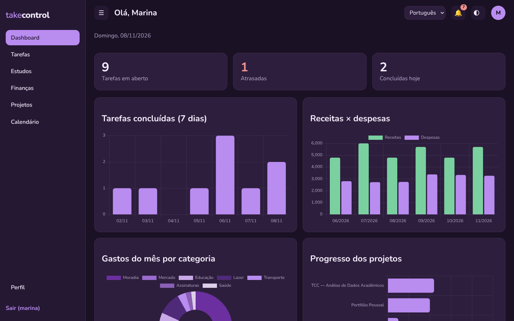

> **Sobre este repositório:** apresenta o projeto (funcionalidades, decisões técnicas e telas).
> O código-fonte é mantido em um repositório privado. Todas as imagens usam **dados fictícios**
> (persona "Marina Costa").

---

## Sobre

O **Take Control** centraliza a organização do dia a dia em um único sistema web: o que fazer hoje,
o que estudar, quanto gastei, como andam meus projetos e o que está marcado no calendário.
Os módulos são **integrados de verdade pelo banco de dados** — uma prova vira tarefa, uma tarefa
pertence a um projeto, e tudo aparece no calendário e no dashboard sem duplicar registros.

Foi construído para uso pessoal, com foco em **consistência dos dados**, uma interface
**minimalista e confortável para o uso diário** e código organizado para continuar evoluindo.

## Funcionalidades

### Dashboard
- Saudação, resumo de tarefas, finanças do mês, projetos em andamento, estudos e agenda do dia.
- **Cinco gráficos com dados reais**: produtividade dos últimos 7 dias, receitas × despesas,
  gastos por categoria, progresso dos projetos e frequência nas disciplinas.
- Anotações rápidas e estados vazios com orientação (nada de gráficos "de mentira").

### Tarefas
- Lista, **Kanban** (arrastar e soltar), semana, mês e calendário — todas sobre a **mesma fonte de dados**.
- Prioridade, categoria, status, data e horário; busca e filtros.
- **Recorrência** (diária, dias úteis, semanal, quinzenal, mensal, anual) sem duplicar ocorrências e preservando o histórico.
- **Checklist/subtarefas** e **anexos** (com download protegido por usuário).
- Vínculo com projetos e com atividades acadêmicas.

### Estudos
- Períodos letivos (ano/semestre) com histórico preservado.
- Disciplinas, horários de aula, provas, trabalhos, atividades e entregas.
- **Frequência e faltas** com alerta ao se aproximar do limite.
- Provas e trabalhos geram uma tarefa vinculada — **uma única vez**, mantendo a referência à atividade original.

### Finanças
- Receitas, despesas, contas (corrente, poupança, dinheiro, cartão), categorias próprias.
- **Transferências entre contas** que movem saldo, mas **não entram como receita nem despesa** nos relatórios.
- **Compras parceladas**: cada parcela é um lançamento com seu vencimento, sem contar o total em duplicidade.
- Limites de gasto por categoria com alertas (perto do limite / limite atingido) e metas financeiras.
- Gráficos de evolução mensal e de gastos por categoria.

### Projetos
- Cards, lista e **timeline**; etapas (milestones), tags e categorias.
- **Progresso calculado** a partir das tarefas e etapas concluídas — nunca fica desatualizado.
- Arquivamento de projetos concluídos com histórico consultável.

### Calendário
- Visões de **dia, semana e mês** com tarefas, provas, entregas, aulas, prazos e etapas de projetos.
- Os eventos são **calculados a partir dos módulos de origem** (nada é copiado) e levam de volta ao registro.
- Filtros por categoria e criação rápida de tarefa a partir de qualquer dia.

### Transversais
- **Notificações internas**: tarefas atrasadas, provas e entregas próximas, prazos de projetos e limites financeiros.
- **PWA instalável**, com layout pensado para o celular.
- Interface em **português e inglês**, **tema claro e escuro**, perfil com foto e recuperação de senha por e-mail.

## Telas

### Visão geral — tema escuro e claro
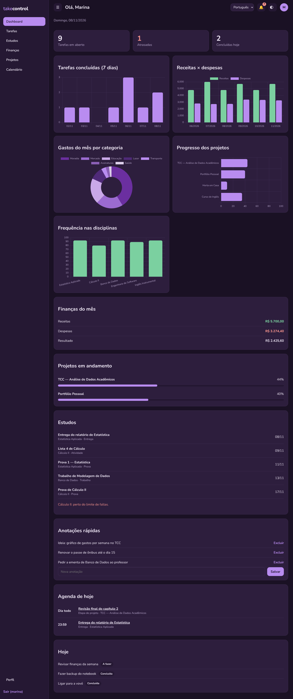
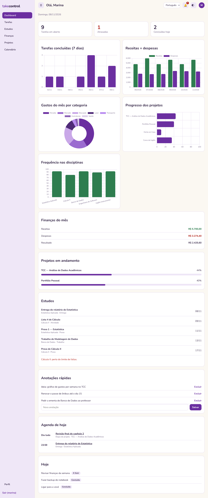

### Finanças
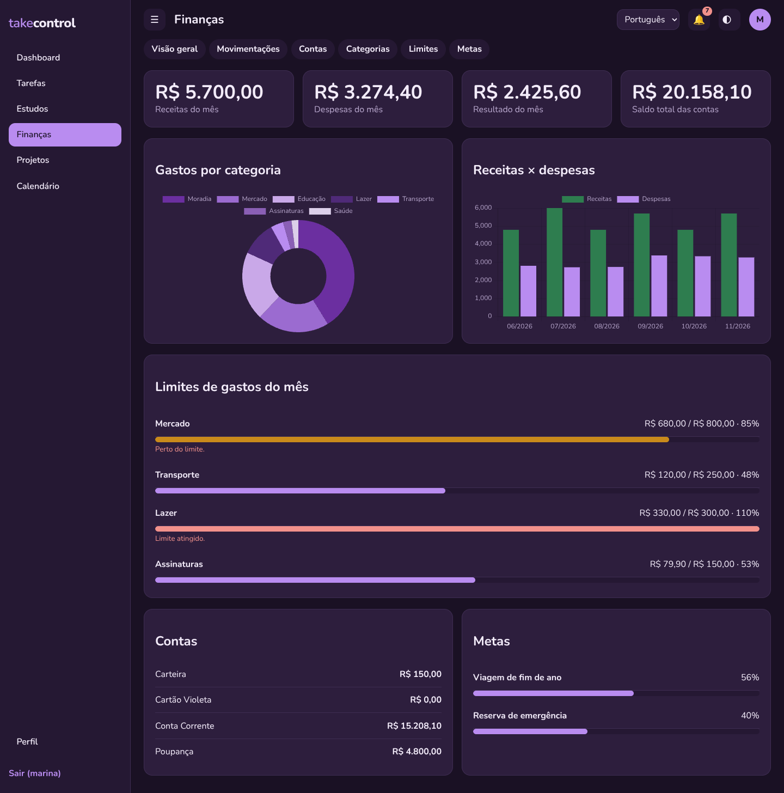

### Tarefas — Kanban
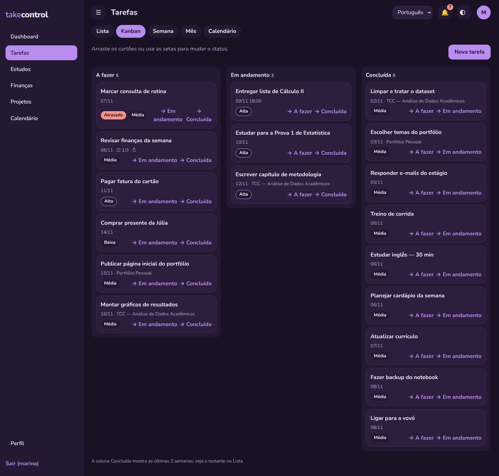

### Projetos
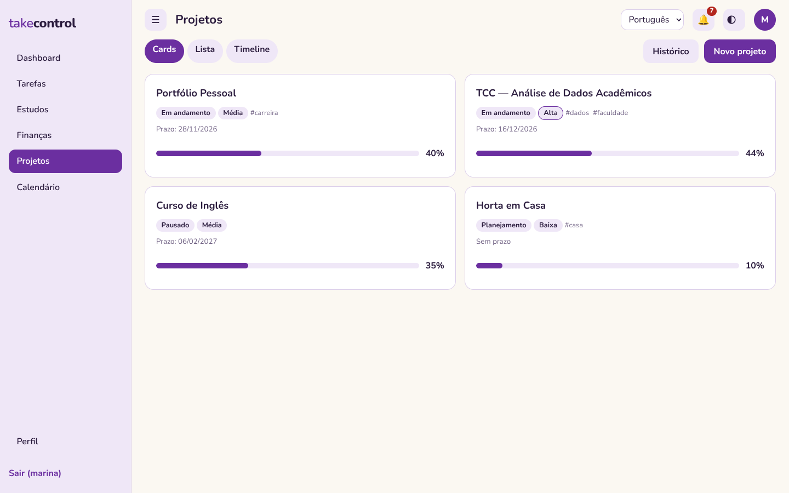
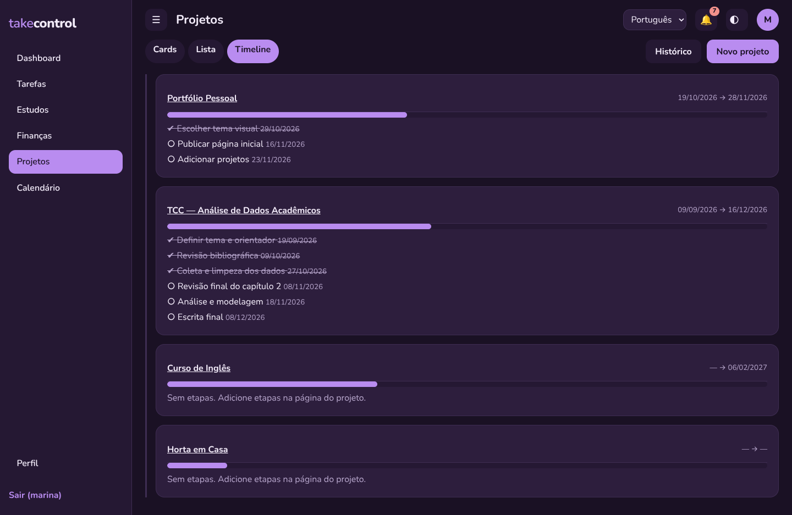

### Estudos
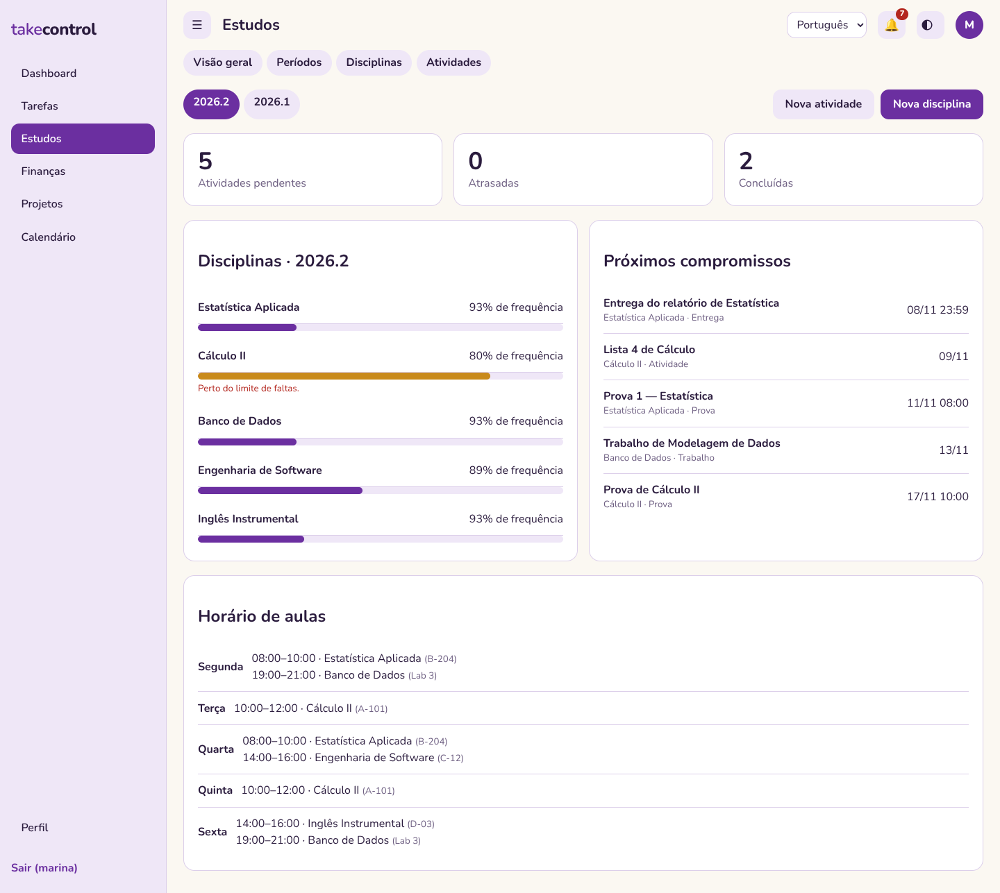

### Calendário
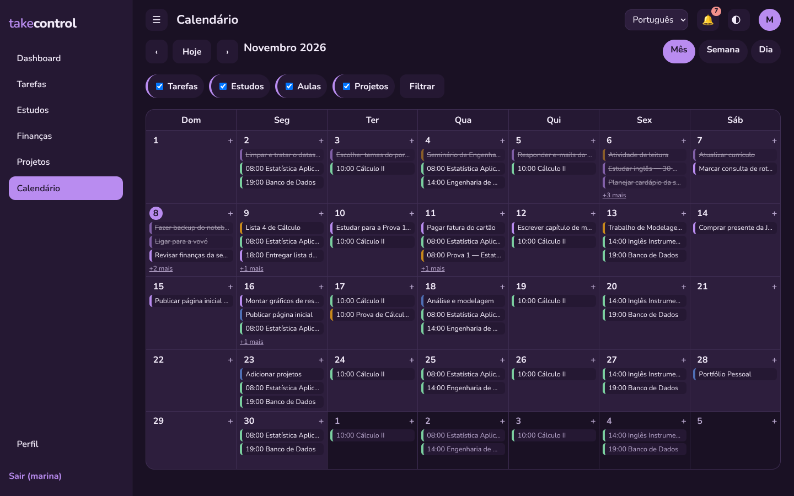

### No celular
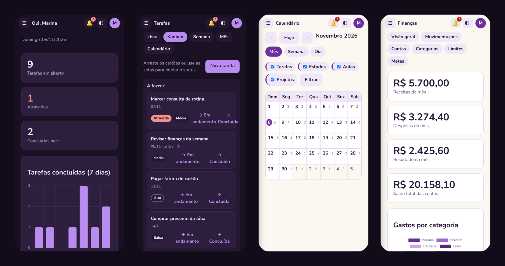

### Login
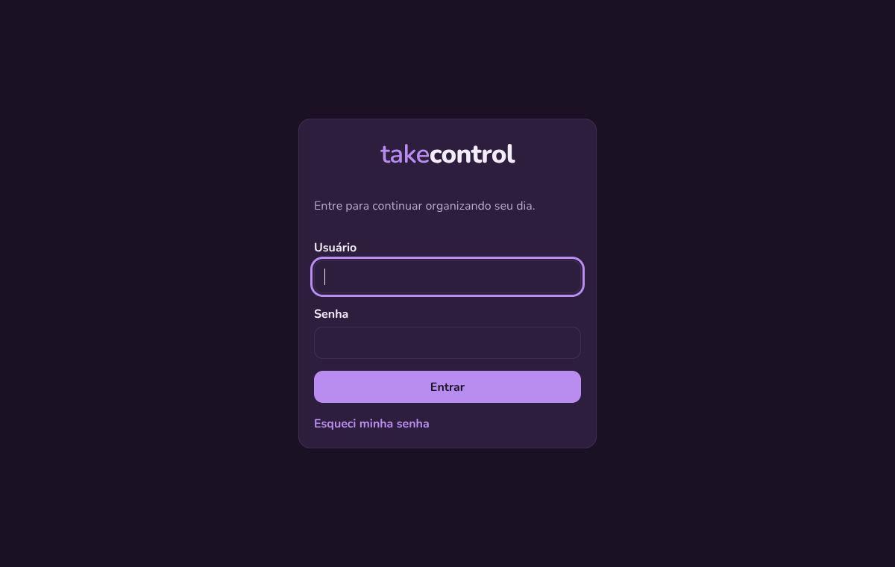

## Decisões de projeto

| Problema | Solução |
|---|---|
| Transferência entre contas não pode inflar receitas/despesas | As duas pernas ficam ligadas por um identificador e **todos os relatórios** partem de uma consulta que só considera receitas e despesas |
| Parcelamento não pode duplicar valores | Cada parcela é uma linha; o total nunca é gravado como lançamento (centavos da divisão vão para a 1ª parcela) |
| Recorrência sem tarefas duplicadas | A próxima ocorrência nasce **ao concluir** a anterior, protegida por uma **restrição única no banco** (série + data) — reabrir e concluir de novo não duplica |
| Progresso de projeto sempre correto | Calculado a partir das tarefas e etapas, em vez de armazenado |
| Calendário sem registros duplicados | Agregação em tempo de consulta, com cada evento apontando para o módulo de origem |
| Dados de um usuário isolados | Toda consulta é filtrada pelo dono; formulários só oferecem objetos do próprio usuário |
| Idioma da interface × dados do usuário | Internacionalização só dos textos do sistema; o que o usuário cadastra nunca é alterado |
| Arquivos anexados | Entregues por uma view autenticada (sem URL pública) e removidos do disco ao excluir |

## Design

Paleta com a regra **60–30–10**: fundo dominante, superfícies/estruturas e um único destaque.

| Papel | Claro | Escuro |
|---|---|---|
| Fundo (60%) | `#FBF8F2` creme | `#1A1124` roxo-noite |
| Superfícies (30%) | `#EFE7F7` lavanda · `#FFFFFF` | `#251833` · `#2D1E3D` |
| Destaque (10%) | `#6B2FA0` violeta | `#B98CF0` lavanda-violeta |
| Texto | `#2A1B3D` | `#F3ECFA` |

Tipografia **Nunito**, animações sutis, estados de foco visíveis e respeito a `prefers-reduced-motion`.

## Stack

- **Backend:** Python 3.12, Django 5.2, Django ORM, PostgreSQL 16, autenticação nativa do Django
- **Frontend:** templates Django, CSS próprio (sem framework), JavaScript puro, Chart.js 4
- **Internacionalização:** Django i18n (PT-BR / EN)
- **PWA:** web app manifest + service worker (somente arquivos estáticos; sem dados offline)

## Arquitetura

Aplicações Django separadas por responsabilidade, com relacionamentos reais entre elas:

```
accounts · core · dashboard · tasks · finance · projects · studies · calendar_app
```

`projects → tasks`, `studies → tasks`, e `dashboard`/`calendar_app` apenas **leem** os demais módulos.

## Qualidade

- **37 testes automatizados** executados em **PostgreSQL**, cobrindo regras de negócio (transferências, parcelas,
  recorrência, frequência, progresso), isolamento entre usuários, PWA, idioma e fluxos de senha.
- Varredura automatizada de **176 páginas** (PT e EN) sem erros de servidor.
- Proteção CSRF, senhas com hash do Django, segredos fora do código (`.env`).

## Roadmap

- [ ] Exportação de dados (CSV)
- [ ] Receitas e despesas recorrentes automáticas
- [ ] Fatura e fechamento de cartão de crédito
- [ ] Busca global
- [ ] Personalização dos widgets do dashboard


